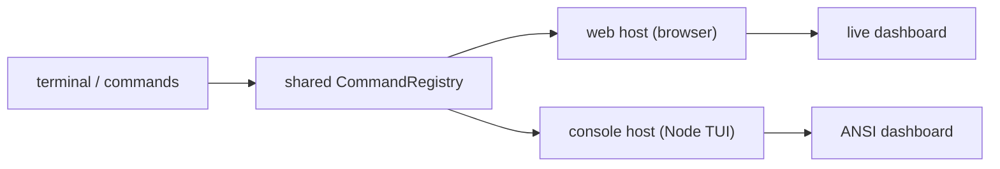

# Tree of Life: Emergence Engineering Sandbox

[](https://github.com/DEzhakieel/tree-of-life/actions/workflows/ci.yml)
[](https://github.com/DEzhakieel/tree-of-life/actions/workflows/pages.yml)
[](LICENSE)
[](package.json)

> **Live dashboard:** https://dezhakieel.github.io/tree-of-life/
> **Docs:** [`docs/`](docs/index.md) · **Thesis:** [`THESIS.md`](THESIS.md) + [`thesis/main.tex`](thesis/main.tex)

A deterministic, **two-engine** (TypeScript + Rust/WASM) artificial-life sandbox
for studying how interactions produce life and cognition — and for *engineering*
emergence: searching controllable parameters, measuring emergence, documenting
and reproducing experiments, and analyzing rare/high-impact (black-swan) events.

Everything is reproducible from a seed, bit-for-bit across both engines, and
driven by **one command layer** that appears both as an in-browser terminal and
as a console dashboard.

## Research focus: critical transitions

The project's single research vertical is **critical transitions / early-warning
signals**. When metabolic load is ramped until the population collapses to
extinction, which generic indicators warn in advance — and does the warning scale
with how slowly the bifurcation is approached? The system is genuinely **bistable**
(low ≈ 40 vs high ≈ 500), so the question is well posed. Result so far (8 seeds ×
6 ramp durations, 48 runs): **variance** is the workhorse indicator (pooled AUC
≈ 0.66), flicker is a distant second (≈ 0.56), autocorrelation-based indicators
are at chance, and skewness is anti-predictive. On a fine τ grid the AUC **declines
monotonically** as the tipping point is approached more slowly — so the
fixed-distance-to-bifurcation prediction is **rejected**. Full charter:
[`docs/SPECIALIZATION.md`](docs/SPECIALIZATION.md).

```bash
npm run research:ews -w @fractal-life/simulation            # full grid -> research/output/ews.*
npm run research:ews -w @fractal-life/simulation -- --quick # fast smoke
```

<details>
<summary><b>Project name note</b></summary>

The project is **Tree of Life** (formerly "Fractal Life v2"). Code identifiers
such as `@fractal-life/*` and `fractal_life_*` are intentionally unchanged.
</details>

## Two surfaces, one system



## Quick start

```bash
git clone https://github.com/DEzhakieel/tree-of-life.git
cd tree-of-life
npm install

npm run dev:web        # dashboard -> http://localhost:5173
npm run terminal       # console dashboard (same commands)
```

In the browser, click **`> terminal`** (bottom-right) and type `help`. In the
console, the ANSI dashboard is live and accepts the same commands.

```bash
npm run typecheck      # tsc --noEmit across workspaces
npm run test:fast      # cheap tier (~1 min, 45/45 files)
npm run build          # server + web
npm run preview        # serve the built dashboard -> http://localhost:3000
```

See [`docs/SETUP.md`](docs/SETUP.md) for the full tutorial and
[`docs/GUIDE.md`](docs/GUIDE.md) for the dashboard + terminal reference.

## Core concepts

- **Deterministic** by `(seed, config)`: replays reproduce byte-exact trajectories.
- **TS reference + Rust/WASM authority** with parity (brain, stochastics, cell
  biology, universe, omics) — verified by bit-identical digests.
- **Opt-in depth** (Phases A–M): disabled subsystems are inert and report
  DORMANT rather than half-simulating.
- **Measurement stack**: hundreds of documented observables, detectors, and a
  pre-registered scope ledger (23 supported / 2 refuted / 9 inconclusive).
- **Reproducible experiments**: documented hypotheses + sha256 digest manifests
  + `--verify`.
- **Black swans**: rare high-impact event detection + joint event-set
  probability (independence + Fréchet bounds).
- **One focused vertical**: critical transitions & early-warning signals —
  a reproducible collapse experiment with pre-registered indicators.
- **Four life substrates**: the agent engine plus pure-TS `particles`,
  `lattice` and `graph` worlds — selectable at creation, same stats/terminal
  surface ([docs/SUBSTRATES.md](docs/SUBSTRATES.md)).

## Terminal commands

`help · status · stats [key] · params · set <k> <v> · play · pause · step <n> ·
spawn <n> · reset · speed <tps> · turbo [on|off] · export · caps · version ·
about · license · cite · docs · platform · echo · clear · quit` (console) plus
`experiment list|run|verify|status`.

Scriptable modes:

```bash
npm run terminal -- --seed demo --steps 1000       # one-shot dashboard
npm run terminal -- --steps 1000 --json            # raw state
"status`nstats tick" | npm run terminal            # pipe a script
```

## Architecture

- `apps/simulation/` — TS engine, research lab, console TUI.
- `apps/web/` — React dashboard, worker/remote sources, in-browser terminal.
- `apps/server/` — REST + WebSocket API (worlds, snapshots, events, interventions, experiment jobs).
- `packages/shared/` — types, binary protocol, and the terminal command layer.
- `packages/shaders/` — shader sources.
- `crates/` — Rust engine + WASM crate (parity with TS).
- `docs/` — published documentation · `thesis/` — LaTeX + bibliography.

Deep dive: [`docs/ARCHITECTURE.md`](docs/ARCHITECTURE.md),
[`docs/REVERSE_ENGINEERING.md`](docs/REVERSE_ENGINEERING.md),
[`apps/simulation/research/manual/`](apps/simulation/research/manual/) (the
exhaustive engineering manual).

## Reproducible experiments

Experiments are immutable records (hypothesis + config + seeds + objectives) that
can be run, saved as a manifest, and reproduced bit-for-bit. Full guide:
[`docs/EXPERIMENTS.md`](docs/EXPERIMENTS.md).

```bash
cd apps/simulation
npx tsx src/research/experimentCli.ts --list
npx tsx src/research/experimentCli.ts --run l3-baseline
npx tsx src/research/experimentCli.ts --verify l3-baseline   # REPRODUCED?
```

The digest includes `LadderResult.worldFingerprint`, so distinct seeds never
collide even when their summary is degenerate.

Three surfaces share the same registry: the **Experiments** panel in the
dashboard (Run / Reproduce with live progress), the REST API at
`/api/experiments` (jobs run on a worker thread — `POST /:id/run` answers 202
immediately), and the terminal:

```text
experiment list | run <id> [--double-check] | verify <id> | status <jobId>
```

On the static GitHub Pages build there is no server, so the panel degrades to
the same catalog **read-only** and tells you how to start the API.


## Research lab

Generators/CLIs live under `apps/simulation/src/research/` with npm scripts:

| Script | Purpose |
|---|---|
| `research:scope` | scope/claims ledger |
| `research:rigor` | rigor assessment |
| `research:ladder` | L1–L3 emergence ladder |
| `research:life` | life-organization rungs (O0–O9) |
| `research:highn` | high-N world selection |
| `research:bench` / `research:known` | benchmarks |
| `research:ai` | LLM-assisted experiment proposal |
| `research:experiment` | run/verify experiments |
| `research:ews` | critical-transition early-warning sweep |

Outputs land in `apps/simulation/research/{output,plots,experiments}/`. See
[`docs/RESULTS.md`](docs/RESULTS.md).

## Testing

`scripts/run-tests.mjs` discovers `test/*.test.ts` per workspace; tiers are data
in `test/tiers.json` (`--fast` for the cheap tier, `--jobs N` to parallelize).
Research tests never write shared state. See
[`apps/simulation/research/TEST_MATRIX.md`](apps/simulation/research/TEST_MATRIX.md).

## Contributing & security

See [`CONTRIBUTING.md`](CONTRIBUTING.md) and [`SECURITY.md`](SECURITY.md).

## License & citation

MIT © 2026 **Daven Ezhakieel**. If you use this work, please cite it — see
[`CITATION.cff`](CITATION.cff) or run `cite` in the terminal.
