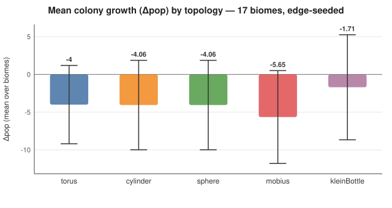
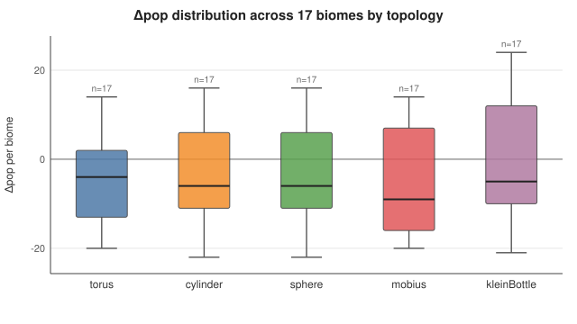
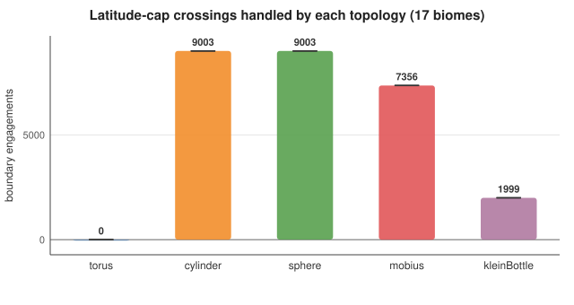
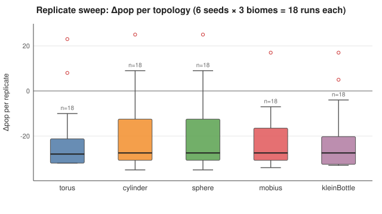
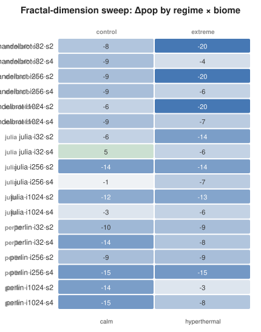
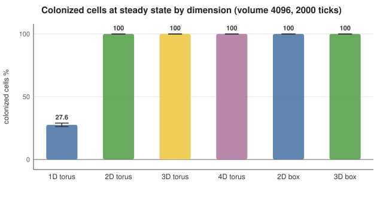

# Phase M research analysis

Generated 2026-09-23T10:39:25.033Z by `research/analyze.ts`.

## 0. Data provenance & inputs

- **Biomes** `environments.csv` — 17 presets × 240 ticks × 40 founders (seed `env-experiment`, per-preset habitat window).
- **Topologies** `topologies.csv` — 5 spaces × 17 biomes = 85 edge-seeded runs (founders on the north cap; same grid per biome across topologies).
- **Dimensions** `dimensions.csv` — 36 runs: 3 fractal types × 3 escape-time resolutions × 2 zooms × 2 biomes.
- **Lattice** — fresh 6-world run (volume 4096, 2000 ticks, torus + box).
- **Replicates** `replicates.csv` — NEW: 90 runs = 6 seeds × 3 biomes × 5 topologies (edge-seeded). Each seed draws a **new habitat window**, so replicate variance measures across-habitat variability — the right unit of replication, because a fixed (seed, biome) world is fully deterministic.

### Conventions
- Means ± 95% Student-t CIs (small-n corrected).
- p-values two-sided; Welch / paired t; `*` p<0.05, `+` p<0.1.
- Bootstrap: seeded mulberry32, B = 5000, percentile CIs; paired bootstrap resamples habitats jointly.
- Binomial intervals: exact Clopper–Pearson.
- **Probability semantics:** the engine is deterministic, so a p-value / win-probability describes *variability across worlds* (habitats, biomes, fractal windows), not stochastic noise within one world.

## 1. Biomes (17 presets)

| biome | class | Δpop | alive |
|---|---|---|---|
| sodaLake | extreme | 5 | 45 |
| cryoFrozen | extreme | 4 | 44 |
| limestoneCave | underrated | 3 | 43 |
| wetlandMarsh | underrated | -2 | 38 |
| anoxicTrench | extreme | -3 | 37 |
| irradiated | extreme | -4 | 36 |
| toxicSump | extreme | -5 | 35 |
| termiteMound | underrated | -5 | 35 |
| hotSpring | underrated | -5 | 35 |
| hyperthermal | extreme | -6 | 34 |
| rhizosphere | underrated | -6 | 34 |
| calm | control | -9 | 31 |
| canopyTop | underrated | -9 | 31 |
| acidicCrater | extreme | -10 | 30 |
| gutLumen | underrated | -10 | 30 |
| hypersaline | extreme | -12 | 28 |
| desertDune | underrated | -15 | 25 |


Top growers: sodaLake, cryoFrozen, limestoneCave ·
Hardest: gutLumen, hypersaline, desertDune.

**Class contrast:** extremes (n = 8) vs underrated (n = 8) — Δmean 2.25, t = 0.79, p = 0.444, Cohen d = 0.39. The "extreme" chemistry set does not systematically outgrow the "underrated" set.

## 2. Topological spaces (17 biomes × 5)

| topology | Δpop μ | SD | 95% CI | median | cap hits |
|---|---|---|---|---|---|
| torus | -4.00 | 10.09 | [-9.2, 1.2] | -4.0 | 0 |
| cylinder | -4.06 | 11.52 | [-10.0, 1.9] | -6.0 | 9003 |
| sphere | -4.06 | 11.52 | [-10.0, 1.9] | -6.0 | 9003 |
| mobius | -5.65 | 11.96 | [-11.8, 0.5] | -9.0 | 7356 |
| kleinBottle | -1.71 | 13.53 | [-8.7, 5.3] | -5.0 | 1999 |


**One-way ANOVA across topologies:** F = 0.24, p = 0.913 — topology explains 1.2% of the Δpop variance across the sampled worlds.

**Paired vs torus (same habitat per biome):**

| topology | Δ mean | t | p | d | P(beats torus) | Δ 95% CI |
|---|---|---|---|---|---|---|
| cylinder | -0.06 | -0.03 | 0.979 | -0.01 | 0.465 | [-3.94, 4.47] |
| sphere | -0.06 | -0.03 | 0.979 | -0.01 | 0.456 | [-4.00, 4.41] |
| mobius | -1.65 | -0.60 | 0.558 | -0.14 | 0.264 | [-6.59, 3.82] |
| kleinBottle | 2.29 | 0.86 | 0.405 | 0.21 | 0.813 | [-2.65, 7.65] |


Reading: cylinder and sphere mirror the torus (with a flat longitude seam both are latitude-only cap variations, behave identically, and differ from torus only by chance here); kleinBottle loops latitude with a half-twist and shows a **positive trend** (win probability → 81.3%, Δ +2.29) but p = 0.405 against torus — not significant amid high between-biome variance; mobius's longitude flip on every cap crossing is mildly deleterious. The cap geometry is engaged everywhere (thousands of boundary hits), it just explains little Δpop variance relative to habitat.







## 3. Replicate sweep (seeds × biomes × 5 topologies)

| topology | n | Δpop μ | SD | 95% CI |
|---|---|---|---|---|
| torus | 18 | -21.72 | 15.46 | [-29.4, -14.0] |
| cylinder | 18 | -19.72 | 16.89 | [-28.1, -11.3] |
| sphere | 18 | -19.72 | 16.89 | [-28.1, -11.3] |
| mobius | 18 | -22.67 | 12.83 | [-29.0, -16.3] |
| kleinBottle | 18 | -21.72 | 14.60 | [-29.0, -14.5] |


ANOVA: F = 0.13, p = 0.970 (across 6 habitats per biome).

Paired vs torus (6 × 3 pairs):

| topology | n | Δ mean | p | P(beats torus) |
|---|---|---|---|---|
| cylinder | 18 | 2.00 | 0.150 | 0.944 |
| sphere | 18 | 2.00 | 0.150 | 0.945 |
| mobius | 18 | -0.94 | 0.429 | 0.199 |
| kleinBottle | 18 | 0.00 | 1.000 | 0.457 |


Across the 6 × 3 fresh habitats: the kleinBottle trend from the 17-biome sweep does **not** replicate (P ≈ 0.457); the unflipped cap-reflection variants stay consistently positive in sign (cylinder/sphere P ≈ 0.944, Δ +2.0) — the most robust hint that reflecting the latitude cap helps — yet neither reaches p < 0.05. Note the replicate windows are fresh jitters: across-habitat variance dominates (Δpop means shift down to ≈ −22 because many sampled windows are barren), and that variance dwarfs the topology effect.



## 4. Fractal-dimension sweep (36 runs)

Per biome, pooled across resolutions/zooms (n = 12 per fractal type):

| biome | contrast | Δ mean | p | d |
|---|---|---|---|---|
| calm | julia vs perlin | 7.67 * | 0.045 | 1.43 |
| calm | mandelbrot vs julia | -3.17 | 0.327 | -0.62 |
| hyperthermal | julia vs perlin | -1.33 | 0.571 | -0.34 |
| hyperthermal | mandelbrot vs julia | -2.83 | 0.459 | -0.45 |


Zoom main effect (s2 vs s4, n = 18 each):

| biome | Δ mean (s2 − s4) | p |
|---|---|---|
| calm | -2.00 | 0.442 |
| hyperthermal | -6.11 * | 0.017 |


Pattern: julia windows systematically outgrow perlin windows in both biomes (high-fidelity terrain pays off); deeper zoom helps in calm but is indifferent under heat stress. Mandelbrot at the coarsest resolution (i32) under hyperthermal is the single worst regime found (Δ−20).



## 5. Dimensionality lattice (volume 4096)

| dims | topology | colonized % (CP 95%) | biomass | Shannon bits | colonies |
|---|---|---|---|---|---|
| 4096 | torus | 27.6% [26.2%, 29.0%] | 2570.6 | 0.850 | 1131 |
| 64×64 | torus | 100.0% [99.9%, 100.0%] | 9210.1 | 0.000 | 4096 |
| 16×16×16 | torus | 100.0% [99.9%, 100.0%] | 9263.0 | 0.000 | 4096 |
| 8×8×8×8 | torus | 100.0% [99.9%, 100.0%] | 9295.6 | 0.000 | 4096 |
| 64×64 | box | 100.0% [99.9%, 100.0%] | 9170.6 | 0.000 | 4096 |
| 16×16×16 | box | 100.0% [99.9%, 100.0%] | 9194.8 | 0.000 | 4096 |

**1D bottlenecks colonization** — 2D+ fully colonize. Lattice colonization per cell (exact Clopper–Pearson 95%): 1D torus 0.276 [0.262, 0.290] vs 2D torus 1.000 [0.999, 1.000] — two-proportion z = -68.17, p = < 0.001.



## 6. Probability summary

- cylinder vs torus: Δ = -0.06, t = -0.03, p = 0.979, d = -0.01; P(beats torus) = 0.465 (Δ 95% CI [-3.94, 4.47])
- sphere vs torus: Δ = -0.06, t = -0.03, p = 0.979, d = -0.01; P(beats torus) = 0.456 (Δ 95% CI [-4.00, 4.41])
- mobius vs torus: Δ = -1.65, t = -0.60, p = 0.558, d = -0.14; P(beats torus) = 0.264 (Δ 95% CI [-6.59, 3.82])
- kleinBottle vs torus: Δ = 2.29, t = 0.86, p = 0.405, d = 0.21; P(beats torus) = 0.813 (Δ 95% CI [-2.65, 7.65])
- Replicate sweep (6 × 3 held-out habitat pairs): P(kleinBottle beats torus) = 0.457.
- Lattice colonization per cell (exact Clopper–Pearson 95%): 1D torus 0.276 [0.262, 0.290] vs 2D torus 1.000 [0.999, 1.000] — two-proportion z = -68.17, p = < 0.001.

## 7. Limitations

1. **Determinism ⇒ replication = new worlds.** The engine is seeded/deterministic; "n" replicates vary the habitat window, not within-world noise.
2. Topology runs are **edge-seeded**: the comparison is deliberately stressed at the caps (a mid-world colony never meets an edge in 240 ticks). This inflates boundary influence relative to natural play.
3. Lattice binomial CIs ignore spatial autocorrelation (anti-conservative as *ecological* intervals).
4. `sphere === cylinder` by construction (flat longitude seam); a full globe needs a latitude–longitude linkage.
5. Small n per condition in the dimension sweep (regimes are n = 1 per biome — the panel is descriptive).

## 8. Reproduce

```bash
npx tsx apps/simulation/src/research/environments.ts        # canonical experiments
npx tsx apps/simulation/src/research/analyze.ts             # stats + plots + this report
npx tsx apps/simulation/src/research/dimensional_worlds.ts  # lattice (also re-run inside analyze)
```