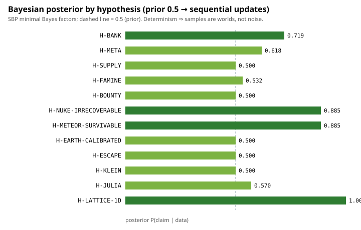

# Phase M+ — Bayesian hypothesis ledger

Generated 2026-09-23T11:27:24.085Z by `research/bayes.ts`.

## 0. Method

Sellke–Berger–Pericchi minimal Bayes factor: BF = 1/(-e·p·ln p) for p < 1/e, else 1; binomial LR for recovery claims; directional claims credit only sign-consistent effects; null claims update with the reciprocal BF (maximal support for the null). Sequential updates multiply odds; same-data re-runs are idempotent (evidence IDs absorb once).

Determinism caveat: every sample is a different world (seed/habitat/biome); posteriors describe belief about effects **across worlds**.

## 1. Hypotheses and posteriors

| id | claim | prior0 | posterior | verdict |
|---|---|---|---|---|
| H-BANK | Shrinking the energy bank (capacity 100 → 25) lowers standing population across habitats. | 0.50 | **0.72** | support |
| H-META | Raising basal metabolism (1.0 → 1.5) shifts standing populations down. | 0.50 | **0.62** | lean |
| H-SUPPLY | Raising food regeneration (supply) raises colony growth. | 0.50 | **0.50** | undecided |
| H-FAMINE | Supply destruction (catastrophic food loss) depresses standing population on every habitat. | 0.50 | **0.53** | lean |
| H-BOUNTY | A one-shot resource pulse (bounty) raises population when the habitat can absorb it. | 0.50 | **0.50** | undecided |
| H-NUKE-IRRECOVERABLE | A total-cull event is NOT recoverable within 4× the developmental horizon (no recolonization). | 0.50 | **0.89** | support |
| H-METEOR-SURVIVABLE | A spatially-localized impact (meteor at the colony centroid) is survivable — colonies persist. | 0.50 | **0.89** | support |
| H-EARTH-CALIBRATED | Earth-like physics laws are indistinguishable from legacy physics (calibration tie-out, no effect). | 0.50 | **0.50** | undecided |
| H-ESCAPE | The escape-window (universe constant) materially changes growth outcomes. | 0.50 | **0.50** | undecided |
| H-KLEIN | The klein bottle boundary (non-orientable cap loop) differs from the torus in cap-growth. | 0.50 | **0.50** | undecided |
| H-JULIA | Julia-set terrain outgrows perlin terrain at matched biome/resolution (terrain complexity pays). | 0.50 | **0.57** | lean |
| H-LATTICE-1D | 1D lattices bottleneck colonization relative to 2D (dimensional phase change). | 0.50 | **1.00** | strong support |

## 2. Evidence ledger (quantitative → qualitative)

### H-BANK — posterior 0.72 (support)

**Claim:** Shrinking the energy bank (capacity 100 → 25) lowers standing population across habitats.

**Qualitative explanation:** The energy bank is the only buffer against an unlucky sequence of metabolic costs; a 4× smaller reservoir converts ordinary cost jitter into die-offs, so colonies lose agents before they can offset losses with births.

- **cosmos energy.bank.small vs control (dPop, n=4)** — paired n=4: Δmean=-12.00, t=-3.27, df=3, p=0.047, BF≤2.56 → BF = 2.56

Update history: 1 update(s); latest posterior 0.72 at 2026-09-23T11:11:34.556Z.

### H-META — posterior 0.62 (lean)

**Claim:** Raising basal metabolism (1.0 → 1.5) shifts standing populations down.

**Qualitative explanation:** Higher basal charge spends the same income faster: every agent pays more per tick, growth margins shrink, and (at this energy-rich baseline) the cost never converts into extra activity that could pay it back.

- **cosmos energy.meta.high vs control (dPop, n=4)** — paired n=4: Δmean=-4.50, t=-2.38, df=3, p=0.098, BF≤1.62 → BF = 1.62

Update history: 1 update(s); latest posterior 0.62 at 2026-09-23T11:11:34.556Z.

### H-SUPPLY — posterior 0.50 (undecided)

**Claim:** Raising food regeneration (supply) raises colony growth.

**Qualitative explanation:** Supply elasticity is live: regen feeds the standing resource pool that populations graze on, so a 10× higher regen should convert into more headcount — the effect is expected to be noisy across habitats because barren windows constrain how much supply can be captured.

- **cosmos supply.high vs control (dPop, n=4)** — paired n=4: Δmean=16.00, t=0.98, df=3, p=0.401, BF≤1.00 → BF = 1.00
- **cosmos supply.low vs control (dPop, n=4; sign-gated)** — paired n=4: Δmean=-0.75, t=-3.00, df=3, p=0.058, BF≤1.00 (sign opposes claim → BF=1) → BF = 1.00

Update history: 2 update(s); latest posterior 0.50 at 2026-09-23T11:27:03.693Z.

### H-FAMINE — posterior 0.53 (lean)

**Claim:** Supply destruction (catastrophic food loss) depresses standing population on every habitat.

**Qualitative explanation:** Food is the shared public capital: wiping it out at a fixed tick removes the population's only growth margin for the rest of the window, so the standing population after a famine tracks the famine, not the habitat.

- **cosmos swan.famine vs swan.none (dPop, n=4)** — paired n=4: Δmean=-10.75, t=-1.62, df=3, p=0.203, BF≤1.14 → BF = 1.14

Update history: 1 update(s); latest posterior 0.53 at 2026-09-23T11:11:34.556Z.

### H-BOUNTY — posterior 0.50 (undecided)

**Claim:** A one-shot resource pulse (bounty) raises population when the habitat can absorb it.

**Qualitative explanation:** A pulse is an option, not a floor: it only converts into headcount where the window already supports reproduction; on barren windows the pulse is consumed and forgotten within a few ticks.

- **cosmos swan.bounty vs swan.none (dPop, n=4)** — paired n=4: Δmean=21.00, t=1.00, df=3, p=0.391, BF≤1.00 → BF = 1.00

Update history: 1 update(s); latest posterior 0.50 at 2026-09-23T11:11:34.556Z.

### H-NUKE-IRRECOVERABLE — posterior 0.89 (support)

**Claim:** A total-cull event is NOT recoverable within 4× the developmental horizon (no recolonization).

**Qualitative explanation:** With no immigration and no founder seed, an empty world has no mechanism to re-seed itself: extinction is absorbing at this horizon because recovery requires births from survivors, and a true cull leaves none.

- **cosmos swan.nuke recovery** — binomial: 0/4 recovered, θ̂=0.17, LR=7.72 → BF=7.72 (vs chance 0.5) → BF = 7.72

Update history: 1 update(s); latest posterior 0.89 at 2026-09-23T11:11:34.556Z.

### H-METEOR-SURVIVABLE — posterior 0.89 (support)

**Claim:** A spatially-localized impact (meteor at the colony centroid) is survivable — colonies persist.

**Qualitative explanation:** A localized shock removes agents only inside its radius; the colony's spatial spread and the surviving out-of-radius agents provide both the population floor and the reproduction needed to recover within ticks.

- **cosmos swan.meteor recovery** — binomial: 4/4 recovered, θ̂=0.83, LR=7.72 → BF=7.72 (vs chance 0.5) → BF = 7.72

Update history: 1 update(s); latest posterior 0.89 at 2026-09-23T11:11:34.556Z.

### H-EARTH-CALIBRATED — posterior 0.50 (undecided)

**Claim:** Earth-like physics laws are indistinguishable from legacy physics (calibration tie-out, no effect).

**Qualitative explanation:** The engine's legacy climb cost was calibrated to Earth gravity (4.0 ≈ 9.81 × 0.408), so Earth-like law should reproduce legacy dynamics — a null result here is a *calibration confirmation*, not a trivial non-effect.

- **cosmos law.earth vs control (dPop, n=4)** — paired n=4: Δmean=-0.50, t=-0.77, df=3, p=0.495, BF≤1.00 → BF = 1.00

Update history: 1 update(s); latest posterior 0.50 at 2026-09-23T11:11:34.556Z.

### H-ESCAPE — posterior 0.50 (undecided)

**Claim:** The escape-window (universe constant) materially changes growth outcomes.

**Qualitative explanation:** The escape radius shapes the fractal iteration texture (hazard/energy terrain) rather than actual escape dynamics at these speeds; changing it re-samples the growth surface, so the sign of the effect can flip by habitat.

- **cosmos escape.small vs control (dPop, n=4)** — paired n=4: Δmean=12.00, t=1.03, df=3, p=0.380, BF≤1.00 → BF = 1.00

Update history: 1 update(s); latest posterior 0.50 at 2026-09-23T11:11:34.556Z.

### H-KLEIN — posterior 0.50 (undecided)

**Claim:** The klein bottle boundary (non-orientable cap loop) differs from the torus in cap-growth.

**Qualitative explanation:** Edge-seeded founders engage the boundary immediately; if the flipped cap-loop reorganises dispersal, Δpop distributions should separate — but between-biome variance is large, so this needs the 17-biome paired panel to even be visible.

- **topologies kleinBottle vs torus (Δpop, n=17 biomes)** — paired n=17: Δmean=2.29, t=0.86, p=0.405, BF≤1.00 → BF = 1.00

Update history: 1 update(s); latest posterior 0.50 at 2026-09-23T11:11:34.556Z.

### H-JULIA — posterior 0.57 (lean)

**Claim:** Julia-set terrain outgrows perlin terrain at matched biome/resolution (terrain complexity pays).

**Qualitative explanation:** Julia windows concentrate resource structure into coherent patches that colonies can exploit, while perlin noise spreads the same resource thinly; the advantage should appear as higher Δpop at matched zoom/resolution.

- **dimensions julia vs perlin (Δpop)** — welch n=12/12: Δmean=3.17, t=1.53, p=0.142, BF≤1.33 → BF = 1.33

Update history: 1 update(s); latest posterior 0.57 at 2026-09-23T11:11:34.556Z.

### H-LATTICE-1D — posterior 1.00 (strong support)

**Claim:** 1D lattices bottleneck colonization relative to 2D (dimensional phase change).

**Qualitative explanation:** At fixed volume, a 1D chain has only 2 neighbours per cell: any blockage severs the network, while 2D+ give the colony alternate routes around poor cells — the prediction is a hard phase change between 1D and 2D, not a smooth gradient.

- **lattice 1D vs 2D colonization (z-test, 1130/4096 vs 4096/4096)** — two-proportion z=-68.19, p=0.00e+0, BF≤1000000 → BF = 1000000.00

Update history: 1 update(s); latest posterior 1.00 at 2026-09-23T11:11:34.556Z.

## 3. Reading guide

- BF ≤ 1/(-e·p·ln p) is the *minimal* Bayes factor: with n = 4 worlds, even p = 0.05 can only push a 0.5 prior to ≈ 0.71. Posterior strength is bounded by the sample size of worlds, not by enthusiasm.
- Posterior ≥ 0.9 in this ledger therefore means either very strong p-values (large n or huge effects) or repeated independent evidence.
- A `null` claim (H-EARTH-CALIBRATED) believes the absence of an effect: it updates with the reciprocal BF (maximal support for the null) and its support is exactly the absence of evidence of an effect. With the current n=4 tie-out that support stays at 0.50 — an honest "cannot decide".
