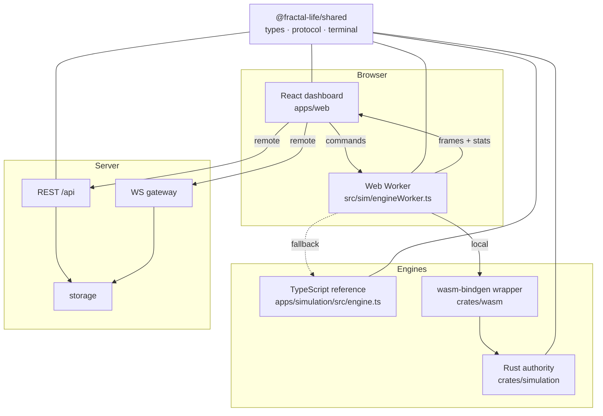
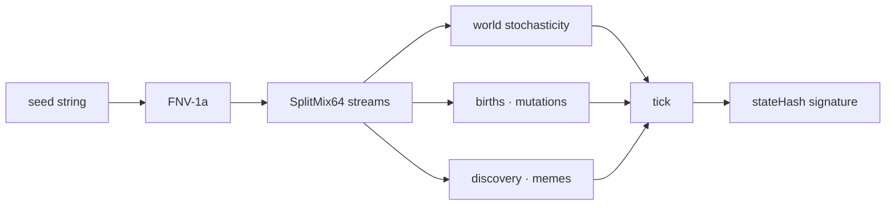
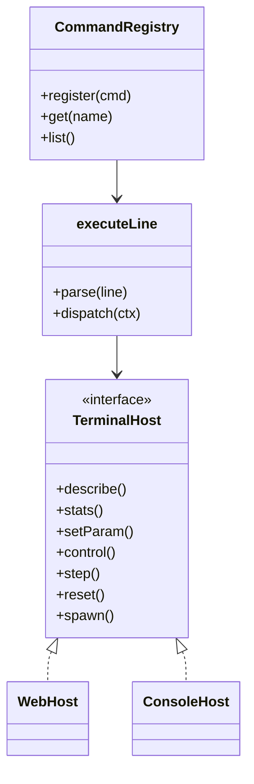

# Architecture

Tree of Life is a monorepo with **two interchangeable engines** behind one
binary protocol, a browser dashboard, an HTTP/WS server, and a research lab.

## Engines and runtimes

- **TypeScript reference engine** (`apps/simulation/src/engine.ts`) — the
  readable specification. Drives the console TUI, the research lab, and the web
  fallback.
- **Rust/WASM authority engine** (`crates/simulation` + `crates/wasm`) — the
  performance authority. The WASM build is committed at
  `apps/web/public/wasm/` so the dashboard never needs a Rust toolchain.
- **Parity contract** — both engines draw from the same seeded RNG streams and
  perform the same updates in the same order, so a world's binary snapshot
  digests match (verified by the experiment runner).

## Determinism

Every stochastic path draws from a `SplitMix64` stream keyed by
`(worldSeed, streamTag, tick[, agentId])`. There is **no `Math.random`** in
engine or research code. The engine's `stateHash` is a rolling FNV‑1a over the
live agent state; two runs of the same seed diverge only if a mechanic changes.

## The tick pipeline

One tick is a fixed, ordered pipeline. Order is part of the specification: the
Rust engine must reproduce it exactly.

```mermaid
flowchart TD
  A["day/night + seasons"] --> B["stochastic world<br/>(weather, OU, Poisson bursts)"]
  B --> C["ecology grounding"]
  C --> D{"per agent (ascending id)"}
  D --> D1["orbit z, z^2+c"]
  D1 --> D2["chemistry terrain sample"]
  D2 --> D3["neighbour scan"]
  D3 --> D4["pattern drives -> thrust"]
  D4 --> D5["movement + slope"]
  D5 --> D6["metabolism + climb tax"]
  D6 --> D7["water"]
  D7 --> D8["feed"]
  D8 --> D9["chemistry"]
  D9 --> D10["DNA"]
  D10 --> D11["omics"]
  D11 --> D12["cells"]
  D12 --> D13["cell bio"]
  D13 --> D14["immune"]
  D14 --> D15["metabolism"]
  D15 --> D16["predator-prey"]
  D16 --> D17["dormancy"]
  D17 --> D18["repro gene tracking"]
  D18 --> D19["costly signalling"]
  D19 --> D20["greenbeard donation"]
  D20 --> D21["memetic imitation"]
  D21 --> D22["reproduction"]
  D22 --> D23["brain learning"]
  D23 --> E["biome re-injection"]
  E --> F["replicator projection<br/>(every 100 ticks)"]
  F --> G["fitness · births · events"]
  G --> H["math · biophysics · phase observables"]
  H --> I["world half:<br/>carrion->meat, decomposition->soil,<br/>plant growth, weathering,<br/>signal diffusion, stats()"]
```

## Data flow to the UI

The worker emits a **binary frame** (agent positions/state), a **stats**
message, and an optional **SET map**. The protocol lives in
`packages/shared/src/protocol/` (`binary.ts` encode/decode, `hash.ts`). The
React layer decodes once into the `AgentBuffer` and reads `SimStats` from the
store. Remote mode replaces the worker with a WebSocket source
(`apps/web/src/net/remoteSource.ts`) speaking the same messages.

## The shared command layer

The terminal is deliberately split into a **platform‑agnostic core** and two
**thin hosts**:

- `packages/shared/src/terminal/` — `types`, `registry`, `commands`
- `apps/web/src/terminal/` — `host.ts` (store + session), `TerminalDock.tsx`
- `apps/simulation/src/tui/` — `session.ts` (engine), `dashboard.ts`, `tui.ts`

Adding a command means editing **one** file (`commands.ts`) and it appears on
both platforms. Adding a platform means implementing **one** interface.

## The research lab

`apps/simulation/src/research/` is a self‑contained lab: detectors
(`emergence*.ts`, `complexity.ts`, `lifeOrganization.ts`), statistics
(`benchmarks/rigor/`), benchmarks, scaling plans, a Bayesian scope ledger, and
an LLM‑assisted experiment proposer (`src/research/ai/`). Each process is a CLI
with a `research:*` npm script and writes deterministic artifacts under
`apps/simulation/research/output/` and `.../plots/`.

See [DESIGN](DESIGN.md) for the rationale and
[REVERSE_ENGINEERING](REVERSE_ENGINEERING.md) for the code↔phenomenon map.
