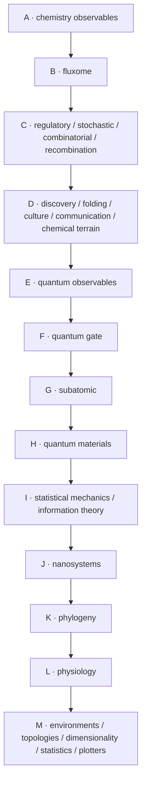
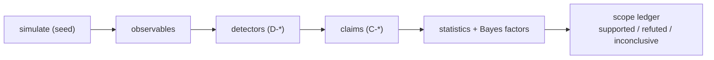

# Design

The design goal is not "a pretty simulation". It is a **reproducible
laboratory** for emergence, where every claim is a measurement and every
measurement is re‑runnable. Five principles drive the architecture.

## 1. One specification, two engines

The TypeScript engine is the *specification*; the Rust engine is the
*authority*. They must agree bit‑for‑bit. This forces the algorithm to be
explicit (no engine‑specific shortcuts) and makes the TS engine readable enough
to audit.

> **Rule.** Any mechanic added to one engine is added to the other in the same
> commit, preserving RNG draw counts and update order.

## 2. Opt‑in depth, inert when off

The system models chemistry → cells → organisms → ecosystems → culture. Running
*all* of it every tick would be wasteful and would confound experiments. So deep
subsystems are **gated behind `WorldConfig` flags** and, when off, report neutral
values (the layers show as `DORMANT`). Turning a flag on is a controlled
perturbation — a clean A/B.

Layers **E, G, H, I, J, K, L** are *readings of the same fold‑cluster pools* —
the TypeScript reference reports zeros for them; only the WASM engine computes
the underlying field. This is a deliberate "measurement without re‑simulation"
design: one substrate, many observables.

## 3. Determinism is a budget, not a hope

All randomness flows through seeded SplitMix64 streams keyed by a tuple. This
buys:

- **exact replay** from a seed,
- **bit‑identical parallelism** (each agent's stream is independent),
- a **signature** (`stateHash`) that acts as a fingerprint for regression tests
  and cross‑engine parity.

## 4. Measurement‑first

Every observable is a first‑class field of `SimStats` with a documented formula
(see `apps/simulation/research/manual/03-mathematical-foundations.md`) and a
detector that turns time series into discrete claims (`emergenceRadar.ts`,
`lifeOrganization.ts`). The lab then tests claims statistically
(`benchmarks/rigor/`) and tracks them in a Bayesian scope ledger.

## 5. Modular, reproducible, experimentable

- **Modular** — shared core has zero platform code; hosts are thin adapters
  (browser `TerminalHost`, console `TerminalHost`, HTTP, WS).
- **Reproducible** — `README`/`SETUP` give exact commands; research processes
  write deterministic artifacts; the experiment runner's `--verify` re‑runs and
  compares digests.
- **Experimentable** — a new experiment is a single file with a CLI guard and an
  npm script; a new terminal command is a single registry entry that lights up
  on both surfaces.

## Design decisions worth calling out

| Decision | Why |
|---|---|
| Binary frames, not JSON, for per‑tick agent state | bandwidth + decode cost at up to 12 000 agents |
| Committed WASM artifact | run/deploy without a Rust toolchain |
| `noUncheckedIndexedAccess: false` in the base config | hot‑loop ergonomics; indices are proven by construction |
| No code comments; a separate `manual/` | keeps the spec and the prose in sync at the doc layer |
| 404.html SPA fallback on Pages | deep links still load the single‑page dashboard |
| Terminal core in `shared`, not in `web` | guarantees web/console command parity |

The trade‑offs and their consequences are recorded in
`apps/simulation/research/manual/05-evaluations-and-debugs.md` (16 debug
post‑mortems with symptom → cause → fix → guard).
