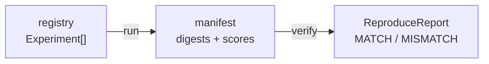

# Tree of Life — Experiments

> How a simulation experiment is defined, run, recorded, and reproduced —
> from the CLI, the dashboard, the REST API, and the terminal.

An **experiment** is an immutable document: a falsifiable hypothesis, a fixed
configuration, a list of seeds, and the objectives it is scored against. Running
one produces a **manifest** (per-seed digests + scores + aggregate), and a
manifest can later be **reproduced bit-for-bit** — or flagged as drift.



## What an experiment is

Defined in `apps/simulation/src/research/experiment.ts`:

| Field | Meaning |
|---|---|
| `id`, `name` | stable id and display name |
| `hypothesis` | falsifiable statement under test |
| `description` | what is manipulated or controlled |
| `tags` | free-form labels |
| `seeds` | deterministic seeds, one outcome each |
| `ladder` | ladder options (`ticks`, `spawnCount`, `overrides`, …) |
| `objectiveIds` | objectives to score (default: `l1/l2/l3-emergent`, `adaptation`) |
| `kind` | `'ladder'` (default) or `'ews'` |
| `ews.ramps` | `ews` only: ramp durations in ticks |
| `createdAt` | ISO timestamp |

Two kinds of run exist today:

- **`ladder`** — the emergence ladder. Each seed scores the objective set;
  ladder cost is roughly **150 s per seed at 6000 ticks** (≈ 35 s at 2000).
- **`ews`** — the critical-transitions grid: burn in for 350 ticks, then ramp
  `metabolismBase` 1 → 40 over τ ticks and score early-warning indicators
  (variance, flicker, AC1, AC, skew) as mean ROC area against the collapse
  tick, with a no-ramp control at the same tick budget. Variance is the pass
  gate (AUC > 0.5 = "variance warns").

## The registry

`apps/simulation/src/research/experimentRegistry.ts` holds the registered
experiments. It uses type-only imports, so the **browser bundles the same
catalog** for offline display.

| id | kind | seeds | question |
|---|---|---|---|
| `l3-baseline` | ladder | 3 | does the default config yield robust L3 emergence? |
| `abundance-lift` | ladder | 2 | does 3× food regen lift steady-state life and speciation without erasing hazard avoidance? |
| `ews-sweep` | ews | 2 | do early-warning indicators rise before a slow metabolism ramp tips the population? |

## Manifests and reproduction

A run writes `apps/simulation/research/experiments/<id>.json`
(`ExperimentManifest`): the experiment itself, objectives, runtime info
(node/platform), one `SeedOutcome` per seed (digest, score, breakdown,
thresholds, verdicts), the aggregate (`meanScore`, `sdScore`, `passRate`), and
`reproducible` — true when a double-run of the first seed produced identical
digests.

Digests are sha256 over the **full world fingerprint** (grid + alive agents)
plus trajectory, summary, and synthesis, so two seeds never collide even when
their summary is degenerate (e.g. nothing alive). For `ews` runs the digest
covers the per-ramp indicator AUCs and lead times instead.

`verify` re-runs every recorded seed and compares digests:

```text
MATCH / MISMATCH per seed → REPRODUCED: all digests bit-identical | FAILED
```

An exit code of 1 means drift — a code change, a dependency bump, or a
non-deterministic path crept in.

## Running it

### 1. CLI (Node)

```bash
npm run research:experiment -w @fractal-life/simulation -- --list
npm run research:experiment -w @fractal-life/simulation -- --run l3-baseline --ticks 2000
npm run research:experiment -w @fractal-life/simulation -- --verify l3-baseline
```

`--out <dir>` redirects where manifests are written (default
`apps/simulation/research/experiments/`).

### 2. Dashboard panel

Left dock → **Experiments**. Each entry shows its kind badge, hypothesis, and
config; **Run** starts the job and streams progress, **Reproduce** re-runs the
recorded manifest and compares digests. A double-check checkbox re-runs the
first seed for bit-exact confirmation.

### 3. REST API

`apps/server/src/api/experiments.ts`, mounted at `/api/experiments`:

| Method | Path | Notes |
|---|---|---|
| `GET` | `/api/experiments` | full catalog (`Experiment[]`) |
| `GET` | `/api/experiments/:id` | one experiment (404 if unknown) |
| `GET` | `/api/experiments/:id/manifest` | recorded manifest, or 404 |
| `POST` | `/api/experiments/:id/run` | **202** + job; body `{ doubleCheck?: boolean }` |
| `POST` | `/api/experiments/:id/reproduce` | **202** + job (404 if no manifest yet) |
| `GET` | `/api/experiments/jobs` | queued/running/recent jobs |
| `GET` | `/api/experiments/jobs/:jobId` | one job with progress |

```bash
curl -s localhost:3000/api/experiments | jq '.experiments[].id'
curl -s -X POST localhost:3000/api/experiments/ews-sweep/run -H 'content-type: application/json' -d '{"doubleCheck":false}'
curl -s localhost:3000/api/experiments/jobs/<jobId> | jq '{status,progress}'
curl -s -X POST localhost:3000/api/experiments/l3-baseline/reproduce
```

### 4. Terminal

The same commands work in the in-browser terminal and the console TUI:

```text
experiment list
experiment run <id> [--double-check]
experiment verify <id>
experiment status <jobId>
```

`run` and `verify` return the job id immediately; poll with `experiment status`.

## Jobs run off the main thread

A ladder or EWS experiment takes minutes, so the server never runs one on the
request thread. `POST /:id/run` enqueues a **FIFO job** executed by a
**worker thread** (`apps/server/src/experiments/worker.ts`), with:

- a **persistent worker** reused across jobs (tsx cold start ≈ 22 s once),
- a **30-minute timeout** and automatic worker restart on crash,
- **manifests written to disk**, so they survive a server restart even though
  the job itself does not.

Jobs stream `{ done, total, label }` progress (per seed, per ramp, or
double-check), which the panel renders as a bar and the terminal prints via
`experiment status`.

## Offline degradation

The dashboard is also published as a static site (GitHub Pages), where no API
server exists. The panel probes `GET /api/health` once, then:

- **online** — catalog from the server; Run / Reproduce enabled;
- **offline** — the bundled registry is shown **read-only**, with a notice to
  start the server (`npm run dev -w @fractal-life/server`) to execute.

The offline path pulls only the browser-safe registry subpath
(`@fractal-life/simulation/research/registry`), so no Node built-ins enter the
bundle.

## Adding an experiment

Register an entry in `experimentRegistry.ts`:

```ts
reg.register({
  id: 'my-experiment',
  name: 'My Experiment',
  hypothesis: '...',
  description: '...',
  tags: ['custom'],
  seeds: ['seed-a', 'seed-b'],
  ladder: { ticks: 2000, spawnCount: 60, maxPopulation: 400 },
  objectiveIds: ['l1-emergent', 'l2-emergent'],
  createdAt: new Date().toISOString(),
});
```

It appears automatically in the CLI `--list`, the dashboard panel, the REST
catalog, and the terminal `experiment list` — no other registration needed.

## Cost cheat-sheet

| Run | Approximate wall time |
|---|---|
| ladder, 2000 ticks | ≈ 35 s / seed |
| ladder, 6000 ticks | ≈ 150 s / seed |
| `ews-sweep` (2 ramps × 2 seeds + control) | minutes |
| worker cold start (first job) | ≈ 22 s (one-time) |

See [`RESULTS.md`](RESULTS.md) for what the EWS grid has already shown, and
[`SPECIALIZATION.md`](SPECIALIZATION.md) for the pre-registered charter.
