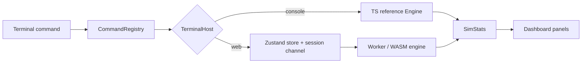

# Guide — dashboard, tools, and terminal

Two surfaces, one system. The **dashboard** is the visual instrument; the
**terminal** is the command surface. They share state: a `pause` typed in the
terminal freezes what you see on the canvas, and a tool used on the canvas shows
up in the next `stats`.



## 1. The dashboard

The canvas (`SceneView`) renders the fractal escape‑time terrain and the agent
field. Panels dock left and right:

| Panel | What it shows |
|---|---|
| **TopBar** | connection, mode (local/remote), tick, population |
| **ModelPanel** | world model, fractal type, seed |
| **StatsPanel** | the headline observables every tick |
| **EventTimeline / EventScheduler** | emergent + scheduled events |
| **EmergenceAtlas / EmergenceRadar** | emergence hierarchies (H1–H3, radar H0–H10) |
| **ObservablesChart** | time series of selected observables |
| **SpeciesPanel** | species list and abundances |
| **LayerPanel** | ground overlay: set / escape / density / energy / culture / gene |
| **LineagePanel** | genealogy tree |
| **AgentInspector / GenomeBrowser** | per‑agent state and genome |

### Tools (bottom toolbar)

| Tool | Effect |
|---|---|
| 🖐 Pan | move the camera |
| ☄ Meteor | kill agents inside a radius |
| 🌾 Seed food | inject food into the terrain |
| 🧬 Spawn | spawn an agent (at the brush centre) |
| ❄ Freeze | pause a region |
| 💥 Nuke | kill everything |
| Brush | radius for the above |
| Time | sim speed (also `set timeScale`) |
| 🌳 Lineage | request + show the genealogy tree |

### Creating a world

`NewWorldModal` builds a world: seed, fractal type, the 15 core world params,
and the opt‑in subsystems (cell biology, biophysics, omics, stochastic omics,
combinatorial, recombination, universe, environment, topology, discovery,
reproduction, sensing, signal deposit, meme copy rate). Anything left off is
**inert** — it reports neutral/DORMANT rather than simulating a half‑field.

## 2. The terminal

Open it in the browser with the **`> terminal`** button, or run the console
(`npm run terminal`). History: ↑/↓. `clear` empties the buffer.

### Commands

| Command | Aliases | Does |
|---|---|---|
| `help [cmd]` | `?`, `h` | list commands, or describe one |
| `status` | `info`, `whoami` | session/world status |
| `stats [key]` | `observables` | print observables, or one field |
| `params` | `world` | print world parameters |
| `set <k> <v>` | `param` | change a numeric world param |
| `play` | `resume`, `run` | resume |
| `pause` | | pause |
| `step [n]` | | advance n ticks (default 1) |
| `spawn [n]` | | spawn n agents (default 1) |
| `reset` | `restart`, `new` | restart the world |
| `speed <tps>` | `tps`, `rate` | target ticks/second |
| `turbo [on\|off]` | | run unpaced (local engine) |
| `export` | `dump` | JSON snapshot of state |
| `caps` | `capabilities` | host platform + verbs |
| `version` · `about` · `license` · `cite` · `docs` | | project metadata |
| `platform` · `echo <t>` · `clear` | `cls` | misc |
| `quit` · `exit` | `q` | *console only* |

### Examples

```
set timeScale 0.25        # slow the world down
pause
step 200                  # advance exactly 200 ticks
stats entropy             # one observable
spawn 10                  # add 10 agents
speed 120                 # 120 ticks/s
export                    # dump JSON
```

## 3. Reading the observables

`stats` prints a canonical subset; `stats <key>` prints any field of
`SimStats` (there are hundreds — chemistry, biology, game theory, mathematics,
biophysics, and the opt‑in Phase E–J omics layers). Headline fields:

- **population / alive / species** — demography
- **entropy / diversity / complexity** — Shannon, Simpson, LMC
- **cooperation / cultureCount / memeEntropy** — social structure
- **energyInequality** — Gini of lifetime energy
- **meanFitness / meanPlasticity / meanSurprise** — selection and learning
- **lyapunovExponent** — chaos (>0 chaotic)
- **stateHash** — the deterministic signature of the tick

## 4. Reproducibility workflows

1. **Fix a seed** (`NewWorldModal`, or `--seed` in the console) → the trajectory
   is fully determined.
2. **Change one knob** (`set`) and compare `stateHash` at a fixed tick.
3. **Script it**: pipe commands to the console, or use the research CLIs
   (`npm run research:*` under `apps/simulation`).
4. **Verify parity**: run the same world on the TS and WASM engines and compare
   the binary snapshot digests (the experiment runner's `--verify` does this).

See [REVERSE_ENGINEERING](REVERSE_ENGINEERING.md) for how to trace a phenomenon
back to the exact code, and [RESULTS](RESULTS.md) for what the lab has measured.
