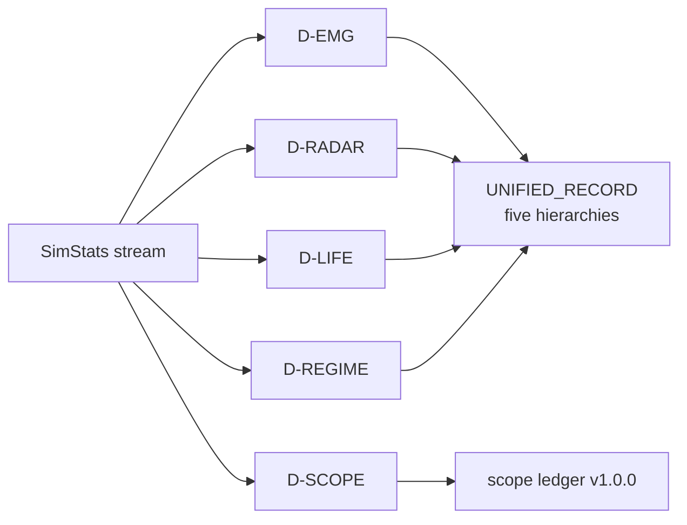

# Mapping

Three cross‑walks connect code, concept, and measurement. The **authoritative**
registers are `apps/simulation/research/SYSTEM_ATLAS.md` (mechanisms, detectors
`D-*`, agents `A-*`) and `SYSTEM_MAP.md`; this page is the navigable summary.

## 1. Module ↔ concept ↔ observable

| Concept | Primary module(s) | Key `SimStats` field(s) |
|---|---|---|
| Fractal world / escape | `terrain.ts`, `engine.ts` (orbit step) | `caAliveFraction`, `terrain*` |
| Movement & physics | `physics.ts`, `engine.ts` | `meanForce`, `clusterCount` |
| Metabolism & energy | `engine.ts`, `ecosystem.ts` | `avgEnergy`, `energyInequality` |
| Chemistry | `engine.ts` (chem), `chemTerrain` | `meanATP`, `chemicalDiversity` |
| Cells & cell biology | `cells.ts` | `meanDivisionProgress` |
| Immune / pathogens | `engine.ts`, `dna.ts` | `meanPathogenLoad`, `meanDNAIntegrity` |
| DNA & mutation | `dna.ts`, `genome.ts` | `meanDNAIntegrity` |
| Game theory | `selection.ts` | `meanAggression`, `meanCooperation` |
| Memetics / culture | `engine.ts` (memetic imitation) | `cultureCount`, `memeEntropy` |
| Reproduction | `engine.ts`, `genome.ts` | `births`, `speciationRate` |
| Learning / brains | `engine.ts` (`brainStats`), POMDP | `meanPlasticity`, `meanSurprise` |
| Ecology grounding | `grounding.ts`, `grounding/` data | `biodiversityIndex` |
| Emergence / complexity | `emergence.ts`, `complexity.ts` | `complexity`, `entropy` |
| Life organization | `lifeOrganization.ts` (shared) | `O0..O9` rungs |
| Calculus / LINCS | `math/` observables | `lyapunovExponent`, `priceEquationSelection` |
| Biophysics (opt‑in) | `engine.ts` (biophysics) | `carnotEfficiency`, `entropyProduction` |

## 2. Detectors (`D-*`) → observable families

Detectors turn a time series into a discrete claim. Representative groups
(full list in `SYSTEM_ATLAS.md §4`):

| Detector group | Reads | Emits |
|---|---|---|
| `D-EMG` emergence | entropy, diversity, complexity | emergence level H1–H3 |
| `D-RADAR` emergence radar | multi‑observable | H0–H10 rungs |
| `D-LIFE` life organization | chemistry + biology + omics | O0–O9 rungs |
| `D-REGIME` macro regime | demographic + energy | regime class |
| `D-SCOPE` claim tests | per‑claim series | supported / refuted / inconclusive |

## 3. Agents (`A-*`) → behavior

`A-*` identifiers name the autonomous decision policies (foragers, predators,
altruists, learners, …). Each maps to the gene indices it reads and the tick
stages it influences. The register is `SYSTEM_ATLAS.md §5`; the genome layout is
`packages/shared/src/genomeBlueprint.ts` (note `GENOME_SIZE = 217`, with
`NOISE_IDX = 115`, `COOP_IDX = 117`, and up to 256‑slot storage).

## 4. Package ↔ responsibility

| Path | Responsibility |
|---|---|
| `packages/shared` | types, `SimStats`, binary protocol, terminal command layer |
| `apps/simulation` | TS engine + research lab + console TUI |
| `apps/server` | REST parity endpoints, WS gateway, storage |
| `apps/web` | dashboard, worker source, remote source, in‑browser terminal |
| `crates/simulation` | Rust authority engine |
| `crates/wasm` | wasm‑bindgen wrapper (`fractal-life-wasm` 0.1.0) |

## 5. Five hierarchies (UNIFIED_RECORD)

| Hierarchy | Range | Source |
|---|---|---|
| Emergence radar | H0–H10 | `emergenceRadar.ts` |
| Life organization | O0–O9 | `lifeOrganization.ts` |
| Emergence | H1–H3 | `emergence.ts` |
| Macro regime | classes | `research/modes.ts` |
| Rigor | a–d | `benchmarks/rigor/` |

These are reconciled into one record (`research/UNIFIED_RECORD.md`) so a finding
is stated once with all its levels. See [RESULTS](RESULTS.md).
