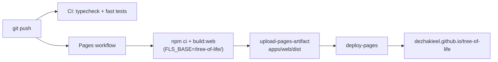

# Publishing (GitHub + GitHub Pages)

Target: **`https://github.com/DEzhakieel/tree-of-life`** with the dashboard on
**`https://dezhakieel.github.io/tree-of-life/`**.

You need one of:

- the **`gh` CLI** (easiest), or
- a **browser** + a GitHub **Personal Access Token** (classic, `repo` scope) for
  the command line, or
- the browser alone (create the repo by hand, then `git push`).

> The repository ships with no remote configured, so the first push is manual.

## Option A — `gh` CLI

```powershell
# from the repository root
gh auth login                                   # once
gh repo create DEzhakieel/tree-of-life --public --source=. --remote=origin --push
```

That creates the repo, sets `origin`, and pushes in one step.

## Option B — existing repo / plain git

1. Create an **empty** public repo named `tree-of-life` (no README, no
   .gitignore) in the browser.
2. Then, from the repository root:

```powershell
git add -A
git commit -m "Tree of Life v1.0.0 — dashboard, research lab, shared terminal"
git branch -M master
git remote add origin https://github.com/DEzhakieel/tree-of-life.git
git push -u origin master
```

If a remote already exists with a different URL:

```powershell
git remote set-url origin https://github.com/DEzhakieel/tree-of-life.git
```

### Using a token (no `gh`)

```powershell
git remote add origin https://<TOKEN>@github.com/DEzhakieel/tree-of-life.git
git push -u origin master
```

Prefer Git Credential Manager if available — it prompts once and stores the
token securely.

## One‑shot script

`scripts/publish.ps1` wraps the commit + remote + push flow:

```powershell
# preview what it will do
powershell -ExecutionPolicy Bypass -File scripts/publish.ps1 -DryRun

# commit everything and push to DEzhakieel/tree-of-life
powershell -ExecutionPolicy Bypass -File scripts/publish.ps1 `
  -Remote https://github.com/DEzhakieel/tree-of-life.git `
  -Message "Tree of Life v1.0.0"
```

## Enable GitHub Pages (the "web" deployment)

The workflow `.github/workflows/pages.yml` builds the dashboard with
`FLS_BASE=/tree-of-life/` and deploys `apps/web/dist`.

1. Repo → **Settings → Pages**.
2. **Build and deployment → Source = GitHub Actions**.
3. Repo → **Actions → "Deploy dashboard to GitHub Pages" → Run workflow**
   (or push to `master`).

The site appears at `https://dezhakieel.github.io/tree-of-life/`.



## Continuous integration

`.github/workflows/ci.yml` runs the fast test tier on Node 18 **and** 20 for
every push and PR. Keep it green before releasing.

## Verify after publishing

```powershell
Start-Process "https://dezhakieel.github.io/tree-of-life/"
gh run list --workflow "Deploy dashboard to GitHub Pages"   # if using gh
```

Hard‑refresh (Ctrl+Shift+R) if you just redeployed — Pages caches aggressively.

## Optional: build this documentation

```bash
pip install mkdocs-material
mkdocs serve      # http://127.0.0.1:8000
mkdocs build      # -> site/
```

To host docs instead of (or alongside) the dashboard, deploy `site/` with a
second Pages workflow — do **not** enable two Pages deployments on one repo
without choosing one as the source.
