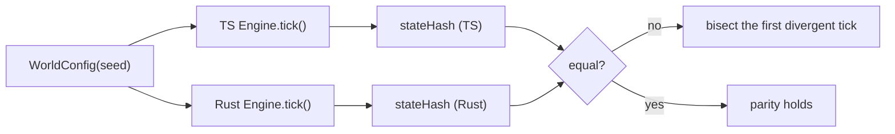
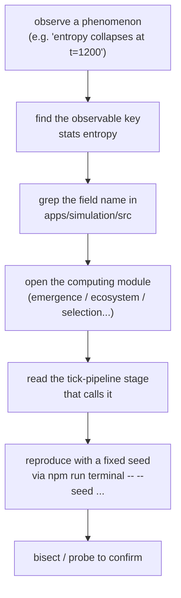

# Reverse engineering

This is a guide to going **from a phenomenon to the exact line of code that
produces it**, and to proving that the TypeScript and Rust engines agree.

## 1. The parity contract

Two engines compute the same tick. The contract has four parts:

1. **Seeded streams** — identical key tuples → identical random draws.
2. **Draw counts** — the *number* and *order* of draws per tick must match.
3. **Update order** — the tick pipeline (see [ARCHITECTURE](ARCHITECTURE.md)) is
   fixed; a mechanic inserted in the wrong place changes trajectories.
4. **Signature** — `stateHash` (FNV‑1a over live state) must match.



## 2. Tracing a phenomenon to code

The engines expose observables, and the lab map ties each observable to the
module that computes it. The fast path:



Useful greps (from the repo root):

```bash
grep -rn "stateHash"        apps/simulation/src
grep -rn "case 'spawnAgent'" apps/simulation/src/engine.ts
grep -rn "lyapunovExponent" apps/simulation/src
```

## 3. The probe toolkit

`probe/` holds small, single‑purpose instruments used during development:

| File | Purpose |
|---|---|
| `probe/bisect.ts` | bisect the first tick where two runs diverge |
| `probe/bisect-blades.ts` | bisect within the "blades" subsystem |
| `probe/trace.ts` | trace an agent's state across ticks |
| `probe/measure.ts` | measure a statistic over a window |
| `probe/parity.ts` | compare TS vs Rust snapshots |
| `probe/parity-blades.ts`, `probe/parity-lineage.ts` | subsystem parity |
| `probe/terrain.ts` | dump/inspect the terrain grid |
| `probe/dump.ts` | serialize state for offline diffing |
| `probe/replay-grounding.ts` | replay an ecology‑grounded world |

And the workspace‑level checks:

- `scripts/browser-check.ts` — headless browser smoke test
- `scripts/ws-smoke.ts` — WebSocket gateway smoke test

The `logs/` folder keeps the historical fix/probe PowerShell scripts
(`apply_phase_d.ps1`, `fix_omics.ps1`, `probe_ticks.ps1`, …) referenced by the
debug post‑mortems in the manual.

## 4. The signature

`SimStats.stateHash` is the compact fingerprint of a tick. Two properties make
it the backbone of regression testing:

- **Order‑sensitive** — reordering updates changes the hash even if the set of
  values is similar.
- **Cheap** — one integer per tick, so a whole trajectory is a small digest
  stream. The experiment runner stores digests and `--verify` re‑computes them.

## 5. Reverse‑engineering workflow (worked example)

Goal: *"why does `complexity` (LMC) peak then collapse?"*

1. `stats complexity` at successive ticks → find the peak.
2. `grep -rn "complexity" apps/simulation/src` → the math observables module +
   the `entropy`/`disequilibrium` computations.
3. Read the tick stage that calls it (math observables, after
   `fitness/births/events`).
4. Fixed seed + `probe/trace.ts` on the dominant species → the collapse tracks a
   **fixation** event (selection entropy → 0, `fixationIndex` → 1).
5. Confirm by re‑running with `set` perturbations; the LMC peak moves only when
   the strategy bins diversify.
6. Record the finding in `apps/simulation/research/` and, if it is a claim, in
   the scope ledger.

The mapping tables that shortcut steps 2–3 are in [MAPPING](MAPPING.md).
