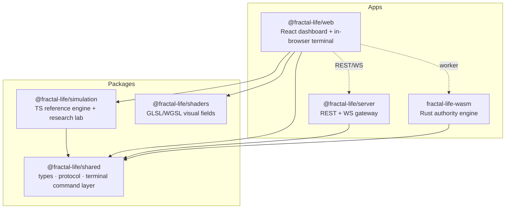

# Tree of Life — Documentation

> Emergent artificial-life simulation on procedural fractal terrain.
> © 2026 Daven Ezhakieel · MIT.

Tree of Life is a **deterministic, dual-engine** artificial-life sandbox and a
matching **research/measurement stack**. Agents evolve, learn, cooperate, and
speciate on fractal escape‑time terrain; every phenomenon is instrumented,
reproducible from a seed, and reproducible bit-for-bit across a TypeScript
reference engine and a Rust/WebAssembly authority engine.

This `docs/` folder is the published, task‑oriented documentation. The
**exhaustive engineering reference** lives next to the code in
`apps/simulation/research/manual/`.

## Start here

| I want to… | Read |
|---|---|
| Install and run it | [SETUP](SETUP.md) |
| Use the dashboard + terminal | [GUIDE](GUIDE.md) |
| Choose a life substrate (particles / lattice / graph) | [SUBSTRATES](SUBSTRATES.md) |
| Run and reproduce experiments | [EXPERIMENTS](EXPERIMENTS.md) |
| Understand how it is built | [ARCHITECTURE](ARCHITECTURE.md) |
| Check the engine's units, invariants, and RNG quality | [MATHEMATICS](MATHEMATICS.md) |
| Understand *why* it is built this way | [DESIGN](DESIGN.md) |
| Map a phenomenon back to code | [REVERSE_ENGINEERING](REVERSE_ENGINEERING.md) |
| See results and evidence | [RESULTS](RESULTS.md) |
| Track claims and falsifiers | [CLAIMS](CLAIMS.md) |
| Find the science it rests on | [REFERENCES](REFERENCES.md) |
| Publish my own copy | [PUBLISH](PUBLISH.md) |
| Read the full thesis | [`../THESIS.md`](../THESIS.md) and [`../thesis/`](../thesis/) |

## The two things you get

1. **A dashboard + terminal** — the same commands in the browser (in‑page
   terminal) and in the console (ANSI TUI). One command registry, two hosts.
2. **A reproducible engine + lab** — TypeScript reference and Rust/WASM
   authority, plus detectors, statistics, benchmarks, and an LLM‑assisted
   experiment proposer under `apps/simulation/src/research/`.

## Conceptual map



## Repository at a glance

```
apps/web           React + Vite dashboard (deployed to GitHub Pages)
apps/server        Fastify-style REST + WS gateway, storage
apps/simulation    TS reference engine + the entire research lab
packages/shared    types, binary protocol, terminal command layer
packages/shaders   shader sources
crates/simulation  Rust engine (parity with TS)
crates/wasm        wasm-bindgen wrapper (authority backend)
docs/              this documentation
thesis/            LaTeX + computational thesis
```

## License & citation

MIT © 2026 Daven Ezhakieel. If you use this work, please cite it —
see [`CITATION.cff`](../CITATION.cff) or run `cite` in the terminal.
